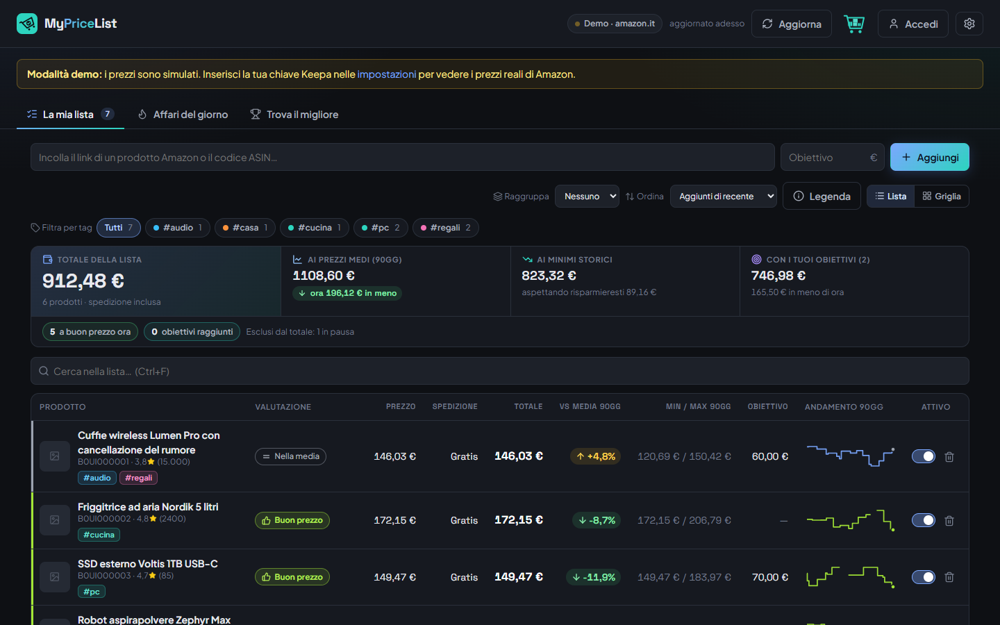

# MyPriceList

Tieni d'occhio i prezzi Amazon.it dei prodotti che ti interessano e scopri quando conviene davvero comprarli.

## [Scarica MyPriceList per Windows](https://github.com/KekkoRebs/mypricelist-download/releases/latest/download/MyPriceList-windows.zip)

Versione attuale: **1.2.1** · Windows 10 e 11 · gratis · [tutte le versioni e le novità](https://github.com/KekkoRebs/mypricelist-download/releases)

## Come installarla (2 minuti)

1. Clicca su **Scarica MyPriceList per Windows** qui sopra: scarichi il file `MyPriceList-windows.zip`.
2. Apri la cartella Download, fai **clic destro sul file → Estrai tutto… → Estrai**.
3. Apri la cartella `MyPriceList` che si è creata e fai doppio clic su **`MyPriceList.exe`**.
4. Se compare **"Windows ha protetto il PC"**: clicca **Ulteriori informazioni** e poi **Esegui comunque**.
   Succede perché l'app non ha una firma digitale (costa diverse centinaia di euro l'anno), non perché sia pericolosa.

Consiglio: sposta prima la cartella `MyPriceList` dove preferisci (per esempio in Documenti), poi fai clic destro su
`MyPriceList.exe` → **Mostra altre opzioni → Invia a → Desktop (crea collegamento)** per avere l'icona sul Desktop.

**Aggiornare**: in ⚙ Impostazioni → **Controlla aggiornamenti** l'app ti dice se c'è una versione nuova.
Scarica lo zip, chiudi l'app (clic destro sull'icona vicino all'orologio → Esci) ed estrai la nuova cartella al posto
della vecchia: la tua lista resta, perché è salvata a parte.

## Cosa fa

- **La tua lista**: incolli il link di un prodotto Amazon.it e vedi prezzo, spedizione, totale e andamento degli ultimi mesi.
- **Etichette chiare**: *Minimo storico*, *Offertissima*, *Buon prezzo*, *Nella media*, *Non conviene*…
- **Affari del giorno**: i cali migliori della tua lista e le offerte del momento su tutto Amazon.it, con quelle *da non perdere*.
- **Trova il migliore**: cerchi un tipo di prodotto e ottieni una classifica basata su voti, recensioni e prezzo.
- **Totale della lista**: quanto spenderesti ora, ai prezzi medi e ai minimi storici.
- **Avvisi via email** quando un prezzo scende, raggiunge il tuo obiettivo o tocca il minimo storico.
- **Account facoltativo** e gratuito: la tua lista salvata online e uguale su ogni PC in cui accedi.
- Tag, ricerca veloce, prodotti in pausa, backup della lista in un file Excel/CSV.

## Da sapere

- **Prezzi dimostrativi all'inizio**: appena installata, l'app mostra **prezzi simulati** per farti provare tutto.
  Per i prezzi veri serve una chiave del servizio [Keepa](https://keepa.com/#!api) (a pagamento), da inserire in ⚙ Impostazioni.
- **I tuoi dati restano sul tuo PC** (cartella `%LOCALAPPDATA%\MyPriceList`), a meno che tu non scelga di creare un account.
  L'app non contatta mai Amazon direttamente.
- Chiudendo la finestra l'app resta attiva vicino all'orologio per aggiornare i prezzi: clic destro sull'icona → **Esci** per chiuderla.
- **Disinstallare**: chiudi l'app (clic destro sull'icona vicino all'orologio → Esci) e cancella la cartella `MyPriceList`
  e la cartella `%LOCALAPPDATA%\MyPriceList`.
- Se Windows blocca l'app senza il pulsante "Esegui comunque", sul PC è attivo **Smart App Control**, che non permette app
  senza firma digitale: per ora su quei PC MyPriceList non si può avviare.

## Problemi o idee?

Scrivi a chi ti ha mandato questo link.
